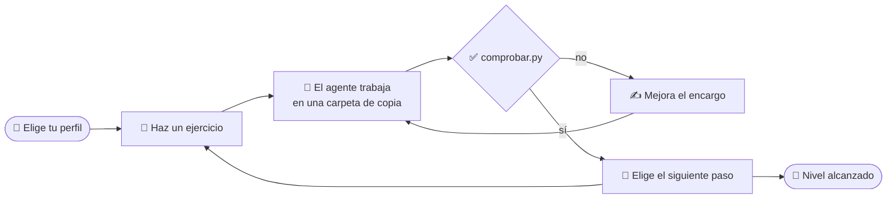
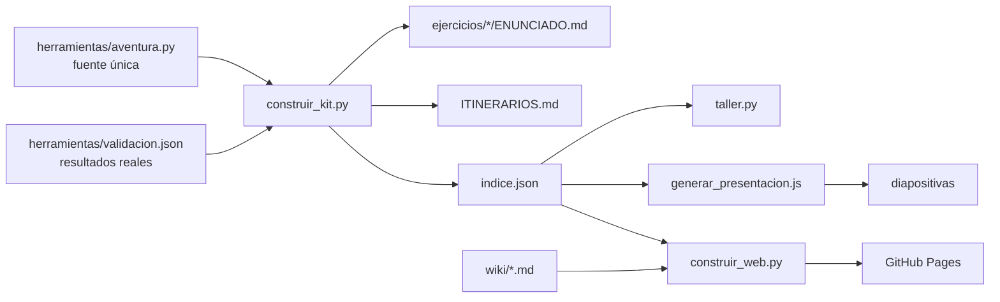

<p align="center">
  
</p>

<h1 align="center">Más allá de ChatGPT: crea y conecta agentes de IA</h1>

<p align="center">
  Taller práctico de la <b>Semana de la IA 2026</b> · Universidad Pública de Navarra<br>
  Viernes 23 de octubre · 17:00 · Aulario de la UPNA
</p>

<p align="center">
  <a href="https://jlasherastracasa.github.io/taller_semana_ia_2026/"><b>🌐 Web del taller</b></a> ·
  <a href="https://jlasherastracasa.github.io/taller_semana_ia_2026/#/wiki/Home"><b>📖 Wiki</b></a> ·
  <a href="https://jlasherastracasa.github.io/taller_semana_ia_2026/#/ejercicios"><b>🧩 Ejercicios</b></a> ·
  <a href="presentacion/taller-agentes-ia.pdf"><b>🖥️ Diapositivas</b></a>
</p>

<p align="center">
  
  
  
  
  
  
  <a href="https://github.com/jlasherasTracasa/taller_semana_ia_2026/actions/workflows/pages.yml"></a>
</p>

<p align="center">
  
</p>

---

## 🚪 Cómo entrar

| Quiero… | Ve a |
|---|---|
| **Ver los ejercicios y mi itinerario** desde el navegador | 🌐 **[jlasherastracasa.github.io/taller_semana_ia_2026](https://jlasherastracasa.github.io/taller_semana_ia_2026/)** |
| **Instalar** (Windows, Linux, macOS) | 🛠️ [Wiki → Instalar](https://jlasherastracasa.github.io/taller_semana_ia_2026/#/wiki/Instalar) |
| **Usar opencode en modo interactivo** | 🖥️ [Wiki → Modo interactivo](wiki/Modo-interactivo.md) |
| **No tengo portátil o no puedo instalar** | 🆘 [Wiki → Plan B](wiki/Plan-B.md): Codespaces en el navegador, en pareja o «en seco» |
| **Instalar y empezar** (paso a paso) | 📖 [Wiki → Primeros pasos](https://jlasherastracasa.github.io/taller_semana_ia_2026/#/wiki/Primeros-pasos) · también en [`wiki/`](wiki/Home.md) |
| Qué **modelo** uso (gratis o con clave) | 🤖 [Wiki → Modelos](wiki/Modelos.md) |
| Entender el **`opencode.json`** | 📖 [Wiki → El fichero opencode.json](wiki/opencode-json.md) |
| Algo **no funciona** | 📖 [Wiki → Problemas y soluciones](wiki/Problemas.md) |
| Las **diapositivas** | 🖥️ [PDF](presentacion/taller-agentes-ia.pdf) · [PowerPoint](presentacion/taller-agentes-ia.pptx) |
| Trabajar en mi portátil | 📁 [`alumnos/`](alumnos/README.md): el kit |

> 📱 En clase, escanea el código QR de la segunda diapositiva: lleva a la web.

## 💡 Qué es

Un taller de unas tres horas para **todos los públicos**: desde quien nunca ha abierto una terminal hasta quien
diseña sistemas. Primero, un poco de historia y de teoría (qué es un modelo de lenguaje, qué es un agente, ReAct, tools, permisos,
skills, MCP, subagentes), con demos en directo.
Después, **cada persona elige su itinerario** entre 38 ejercicios con tareas reales y pone a trabajar a un agente de
verdad —[opencode](https://opencode.ai) en **modo interactivo**, con un modelo gratuito o con GLM-5.3-Flash— en su
propio ordenador (Windows, Linux o Mac), **sin GPU**. ¿Sin portátil? [Plan B](wiki/Plan-B.md).



**La regla del taller:** un ejercicio está bien cuando lo dice el **comprobador**, no cuando el agente dice «Listo».

## 👥 Perfiles

| | Perfil | Para quién | Empieza por |
|---|---|---|---|
| 🧭 | **Explorador/a** | Nunca ha abierto una terminal: jubilados, curiosos | Lista de la compra, factura de la luz, una carta de la Administración |
| 📚 | **Oficina y aula** | Correo, Word y Excel a diario: docentes, administración, pequeños negocios | Resumen del correo, tareas, calendario, corrección con rúbrica |
| 💻 | **Programador/a** | Escribe código y quiere ver las tripas | Bucle ReAct, function calling, tests, revisión de código, MCP |
| 🏛️ | **Arquitecto/a de software** | Diseña sistemas: seguridad, fiabilidad y coste | Permisos, inyección de prompt, subagentes, pass^k |

Los itinerarios completos están en [`alumnos/ITINERARIOS.md`](alumnos/ITINERARIOS.md) y en la web.

## 🧩 Los ejercicios

| Área | Ejercicios | Ejemplos |
|---|:-:|---|
| 🌐 **Webs** | 5 | Web personal, agenda desde una hoja de cálculo, formulario, accesibilidad, publicar en GitHub Pages |
| 📬 **Correo y trámites** | 6 | Resumen de la bandeja, tareas, respuesta a un proveedor, calendario, **carta de la Administración**, **ofertas de luz** |
| 📊 **Informes y presentaciones** | 5 | De informe a presentación, gráfico con totales, revisar y traducir un PowerPoint, informe semanal |
| 🗂️ **Documentos y tareas repetitivas** | 9 | Ordenar Descargas, PDF a tabla, facturas a Excel, certificados, **corregir con rúbrica**, lista de la compra, tareas programadas |
| ⚙️ **Cómo funciona un agente** | 12 | ReAct en 70 líneas, function calling, AGENTS.md, comandos, skills, MCP, tool propia, subagentes, permisos, fiabilidad, tests, **revisión de código** |
| 🛡️ **Prueba de seguridad** | 1 | Un correo con instrucciones ocultas para el agente: obligatoria para todos |
| 🔬 **Reto avanzado** | 1 | Replicar en CPU un artículo científico sobre encoders legales en español |

Cada ejercicio trae su situación, los datos de partida, el encargo listo para copiar, el criterio de éxito, un
comprobador automático, **lo que pasó cuando lo validamos** y dos o tres caminos para seguir.

## 🚀 Empezar en cinco minutos

> 🛠️ Antes: **Python 3.10+**, **Node.js 18+** y **Git** ([cómo instalarlos](wiki/Instalar.md)). **No hace falta
> clave**: sin ella, el agente usa un modelo gratuito de opencode.

🪟 **Windows** (PowerShell):

```powershell
git clone https://github.com/jlasherasTracasa/taller_semana_ia_2026.git
cd taller_semana_ia_2026\alumnos
npm i -g @opencode/cli@2.0.19                          # el agente
py -m venv .venv; .venv\Scripts\Activate.ps1; python -m pip install -r requirements.txt
python taller.py entorno                               # ¿está todo listo?
```

🐧 **Linux** · 🍎 **macOS**:

```bash
git clone https://github.com/jlasherasTracasa/taller_semana_ia_2026.git
cd taller_semana_ia_2026/alumnos
npm i -g @opencode/cli@2.0.19
python3 -m venv .venv && . .venv/bin/activate && python -m pip install -r requirements.txt
python taller.py entorno
```

Y después, en cualquier sistema:

```bash
python taller.py                 # perfiles, áreas (🎥 = demo del profesor) y tu progreso
python taller.py empezar ej24    # prepara la carpeta de trabajo
python taller.py abrir ej24      # opencode en modo interactivo: pega el encargo y míralo trabajar
python taller.py comprobar ej24  # ¿lo hizo de verdad?
```

## 🧪 Validado de verdad

Los ejercicios se volvieron a ejecutar el **11-10-2026** con opencode 2.0.19, solo con CPU, como lo haría un alumno
(`profesor/validar.sh`), y se comprobaron con `comprobar.py`:

- Con **GLM-5.3-Flash**: **38 de 38** cumplen el criterio. F.3 (comandos) y EJ 21 (tareas programadas) se
  validaron en **modo interactivo**, aprobando los permisos uno a uno; F.0 y F.1 son programas de Python.
- Con el **modelo gratuito de opencode** (`big-pickle`, sin clave): **33 de 33** de los que se lanzan
  con un encargo.
- Los que fallaron durante la revalidación se arreglaron mejorando el encargo (EJ 05, EJ 07, EJ 08, EJ 25, F.2) o
  se rehicieron para que funcionen en Windows (EJ 03, EJ 20, EJ 21). Lo que pasó en cada uno está en su enunciado.

Las salidas reales están en [`alumnos/soluciones/`](alumnos/soluciones/README.md).

Lo que salió al prepararlo —y se convirtió en contenido del taller—:

- 🔪 Un agente **mató un proceso que no era suyo** para liberar un puerto.
- ✅ Varios dijeron **«Listo»** sin haber creado el fichero pedido.
- 📂 Lanzado desde un script, un agente **escribió fuera de su carpeta** (opencode usa la variable `PWD`).
- 🔄 De opencode 1.18 a 2.0, en tres semanas, cambiaron **cinco cosas** que rompían ejercicios ([wiki](wiki/opencode-2.md)).

## 💰 Coste

Con el **modelo gratuito de opencode, 0 €**. Tiene un límite de uso por modelo: si se agota, `taller.py lanzar` pasa
solo a otro gratuito y en interactivo basta con `/models` ([wiki → Modelos](wiki/Modelos.md)).

Con **GLM-5.3-Flash en OpenRouter** (respaldo, y para F.0 y F.1): mediana de **0,0084 $ por ejercicio**;
todos los ejercicios una vez, **0,33 $**. Detalle por número de alumnos en
[`profesor/PRESUPUESTO.md`](profesor/PRESUPUESTO.md).

## 📁 Qué hay en el repositorio

```text
taller_semana_ia_2026/
├── alumnos/                 ← EL KIT (lo que usa cada participante)
│   ├── taller.py            ← el mando: entorno · empezar · abrir · comprobar · progreso
│   ├── comprobar.py         ← verifica el criterio de éxito de cada ejercicio
│   ├── ITINERARIOS.md       ← perfiles, áreas, mapa y niveles
│   ├── ejercicios/          ← 38 ejercicios: ENUNCIADO.md + datos de partida
│   ├── soluciones/          ← encargo, salida real y ficheros de la validación
│   ├── replicar_paper/      ← reto avanzado
│   └── opencode.json · requirements.txt · .env.example
├── wiki/                    ← la wiki (también en la web): instalar, modo interactivo, modelos, plan B…
├── .devcontainer/           ← plan B: el kit instalado en GitHub Codespaces
├── presentacion/            ← diapositivas (pptx y pdf), logos y generador
├── profesor/                ← validar.sh, PRESUPUESTO.md y las notas del profesor CIFRADAS
├── herramientas/            ← fuente única (aventura.py) y generadores del kit y de la web
├── archivo/                 ← versiones anteriores (septiembre, opencode 1.18)
└── .github/workflows/       ← publica la web en GitHub Pages en cada push
```



## 🧑‍🏫 Para el docente

| | |
|---|---|
| Validar todos los ejercicios | `bash profesor/validar.sh` (≈ 10 min; `TALLER_MODELO=opencode/big-pickle` para el gratuito) → `python3 herramientas/guardar_soluciones.py <ronda>` |
| Cambiar un ejercicio | Edita `herramientas/aventura.py` y ejecuta `python3 herramientas/construir_kit.py` |
| Regenerar las diapositivas | `cd presentacion/fuente && npm install && node generar_presentacion.js` |
| Ver la web en local | `python3 herramientas/construir_web.py && python3 -m http.server -d _site` |
| Notas del profesor | Solo cifradas en el repositorio: `bash profesor/notas.sh descifrar` (pide la contraseña) |

## 🙌 Créditos

Organiza la **Cátedra Tracasa de Ciencias de la Computación e Inteligencia Artificial** (UPNA · Tracasa
Instrumental) dentro de la Semana de la IA 2026, promovida por el Departamento de Universidad, Innovación y
Transformación Digital del Gobierno de Navarra.

<sub>Logos e imagen del cartel: © Universidad Pública de Navarra, Tracasa Instrumental y Cátedra Tracasa de Ciencias de
la Computación e Inteligencia Artificial, usados para este taller. Tipografía Barlow Condensed (SIL Open Font License).
Las entidades, personas y correos de los ejercicios son ficticios.</sub>
