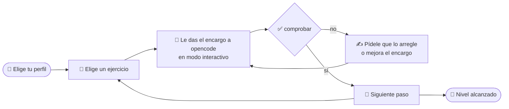

# 🧭 Cómo funciona el taller

No hay un único camino. Cada persona elige su itinerario según su perfil y va eligiendo el siguiente ejercicio.

## 🎥 Demos en directo y ✋ prácticas

| | Quién lo hace | Cómo |
|---|---|---|
| 🎥 **Demo en directo** | El profesor, en el proyector | Explica cada paso mientras el agente trabaja. Tú miras, preguntas y, si quieres, lo repites después |
| ✋ **Práctica** | Tú, en tu ordenador (o en pareja) | A tu ritmo, en clase o en casa. Cuando te atasques o algo no cuadre, **pregunta al profesor** |

Las demos son las que enseñan una pieza nueva del agente:

| Demo | Qué pieza enseña |
|---|---|
| F.0 · El bucle ReAct en 70 líneas | Qué hay dentro de un agente: pensar, actuar, observar |
| F.1 · Function calling | Cómo pide el modelo una herramienta (y quién la ejecuta) |
| EJ 01 · Una web personal | Cómo se trabaja: abrir opencode, pegar el encargo, comprobar |
| F.3 · Comandos | Guardar un encargo con nombre y lanzarlo con `/` |
| F.4 · Skills | Una receta que el agente carga solo cuando la necesita |

Todo lo demás son prácticas. Cada pieza de la teoría tiene al menos una práctica para probarla tú:
AGENTS.md → F.2 · MCP → F.5 · tu propia tool → F.6 · subagentes → F.7 · permisos → F.8 · fiabilidad → F.9 ·
tests → F.10 · inyección de prompt → EJ 10.

## Paso a paso

1. **Elige tu perfil** (`python taller.py` o la web): 🧭 Explorador/a, 📚 Oficina y aula, 💻 Programador/a,
   🏛️ Arquitecto/a. Cada uno tiene un itinerario recomendado; puedes salirte cuando quieras.
2. **Prepara el ejercicio**: `python taller.py empezar ej24` te cuenta la situación y crea tu carpeta de trabajo.
3. **Dale el encargo al agente**: `python taller.py abrir ej24`, pega el encargo y pulsa Enter
   ([🖥️ Modo interactivo](Modo-interactivo.md)).
4. **Compruébalo**: `python taller.py comprobar ej24`. Cuenta como completado solo si lo dice el comprobador. Si el
   agente dice «Listo» y el comprobador dice ❌, manda el comprobador.
5. **Elige el siguiente paso**: cada ejercicio termina con dos o tres opciones.
6. **Haz la prueba de seguridad** (EJ 10): es obligatoria para todos los perfiles.
7. **Mira tu nivel**: `python taller.py progreso` o «Mi progreso» en la web.

## Áreas

| | Área | De qué va |
|---|---|---|
| 🌐 | Webs | Páginas personales, agendas, formularios, accesibilidad, publicar |
| 📬 | Correo y trámites | Resumir y clasificar correos, responder sin enviar, calendario, cartas y facturas de casa |
| 📊 | Informes y presentaciones | Presentaciones, gráficos e informes que se pueden comprobar |
| 🗂️ | Documentos y tareas repetitivas | PDF, Excel, certificados, actas, corrección de exámenes, tareas programadas |
| ⚙️ | Cómo funciona un agente | Bucle, tools, AGENTS.md, comandos, skills, MCP, subagentes, permisos, fiabilidad, tests, revisión de código |
| 🛡️ | Prueba de seguridad | Un correo con instrucciones ocultas para el agente |

## Niveles de dificultad

| | Nivel | Para quién |
|---|---|---|
| 🟢 | Fácil | Sin experiencia: copiar el encargo y mirar qué pasa |
| 🔵 | Medio | Usas el ordenador a diario: lees ficheros, revisas resultados |
| 🟣 | Avanzado | Programas o te manejas con la terminal y la configuración |
| ⚫ | Experto | Diseñas sistemas: seguridad, fiabilidad, arquitectura |

## Nivel alcanzado

| | Nivel | Cómo se llega |
|---|---|---|
| 🥉 | Básico | 3 ejercicios + la prueba de seguridad |
| 🥈 | Intermedio | 6 ejercicios de al menos 3 áreas + la prueba de seguridad |
| 🥇 | Avanzado | Un ejercicio de cada área + la prueba de seguridad + uno de nivel experto |
| ⚠️ | El error más común | Dar algo por bueno sin pasar el comprobador |

## Trucos

- **Conversa**: después de la respuesta, pídele que revise o corrija algo. No hace falta acertar a la primera.
- **Mejora el encargo** y compara: `python taller.py lanzar ej07 --prompt "tu versión"`. ¿Pasa ahora el comprobador?
- **Prueba el agente Plan** (`Shift+Tab` en opencode): analiza y propone sin tocar nada. Útil antes de un encargo
  delicado.
- Si te atascas, compara con `alumnos/soluciones/<ejercicio>/`: está la salida real del agente cuando lo validamos.
