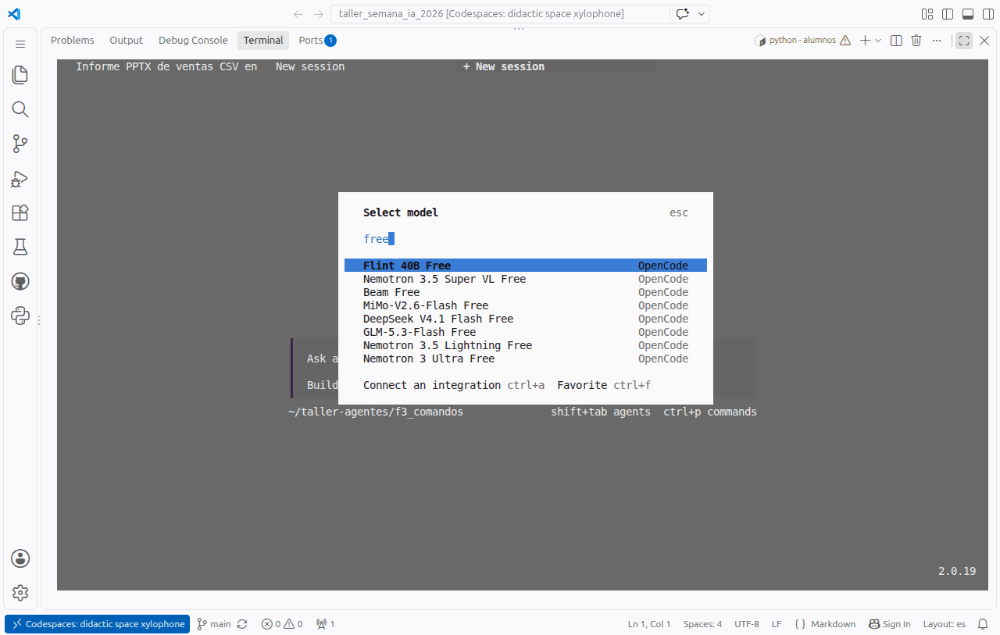
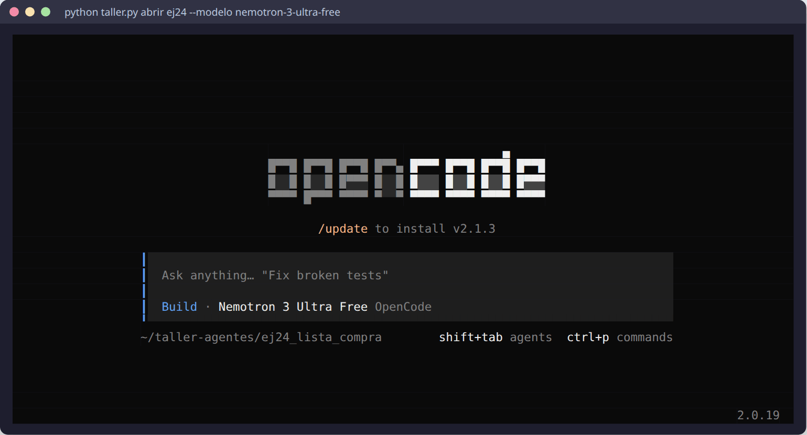
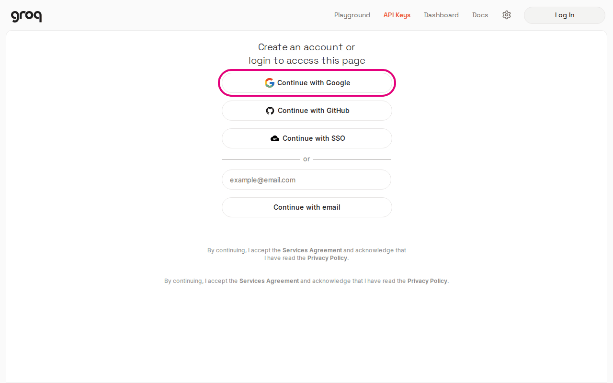
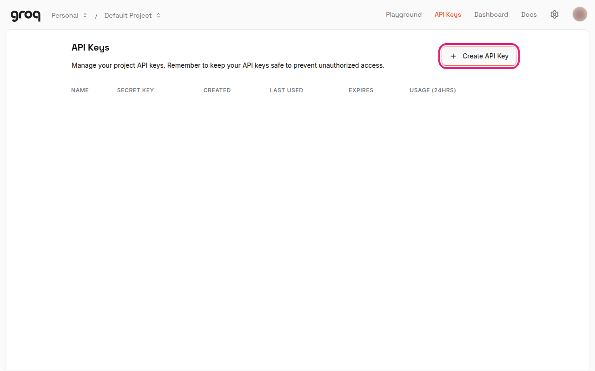
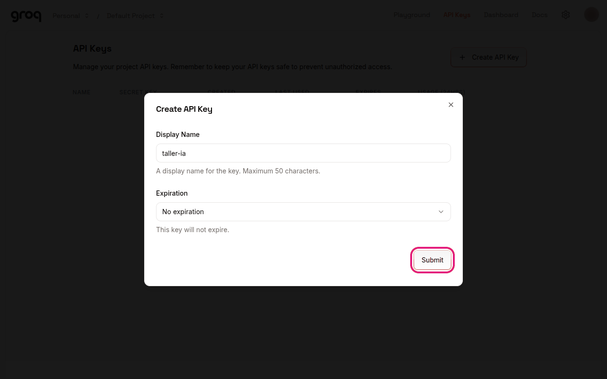
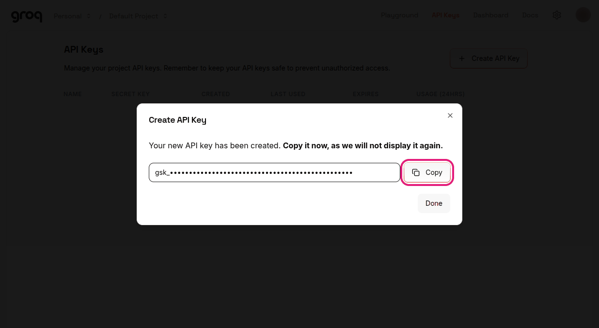
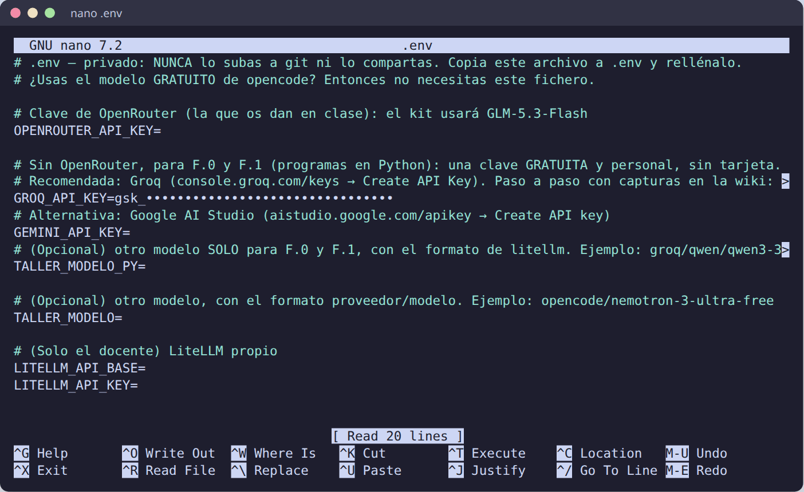
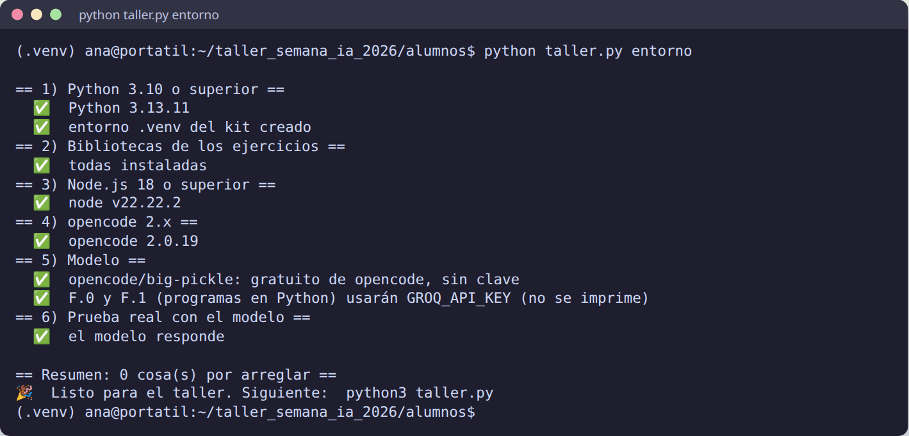

# 🤖 Qué modelo usa el agente

opencode es el **agente** (el programa que lee, escribe y ejecuta); el **modelo** es el «cerebro» al que consulta en
cada paso, y está en internet. El kit elige el modelo solo, según lo que tengas en tu `.env`:

| Tienes… | Modelo | Coste | Para qué |
|---|---|---|---|
| **Nada** (sin `.env`) | `opencode/big-pickle`, gratuito de opencode | 0 € | Todos los ejercicios menos F.0 y F.1 |
| `OPENROUTER_API_KEY` | `openrouter/z-ai/glm-5.3-flash` (GLM-5.3-Flash) | ≈ 1 céntimo por ejercicio | Todos, F.0 y F.1 incluidos. Con él se validaron los ejercicios |
| `GROQ_API_KEY` (**recomendado**) o `GEMINI_API_KEY` | Uno gratuito de Groq o de Google, **solo en F.0 y F.1** | 0 € | Hacer F.0 y F.1 sin OpenRouter. El resto sigue con el gratuito de opencode. Paso a paso, más abajo |
| `TALLER_MODELO` | El que pongas | Depende | Probar otros modelos |

`python taller.py entorno` te dice cuál está usando, y `abrir` y `lanzar` lo muestran al empezar.

## 🆓 Los modelos gratuitos de opencode

opencode ofrece algunos modelos gratis a través de su servicio **OpenCode Zen**. No piden cuenta ni clave.

- **Solo funcionan dentro de opencode.** Por eso F.0 y F.1, que son programas de Python que llaman al modelo
  directamente, necesitan una clave: la de OpenRouter o una gratuita de Groq
  (apartado «F.0 y F.1 gratis», más abajo). En clase, esos dos son demostraciones del profesor.
- **La lista cambia con el tiempo**: un modelo gratuito puede desaparecer o dejar de ser gratis. Para ver los
  disponibles, dentro de opencode escribe `/models`; los gratuitos llevan «Free» en el nombre (también
  `big-pickle`). El 11-10-2026 había, entre otros, `big-pickle`, `nemotron-3-ultra-free`, `mimo-v2.6-flash-free`,
  `step-5-preview-free` y `ling-3.1-flash-free`.
- **Tienen un límite de uso, y es por modelo.** El 11-10-2026, tras unas cien ejecuciones seguidas desde la misma
  conexión, `big-pickle` respondió `Rate limit exceeded` mientras otros gratuitos seguían funcionando. El
  22-10-2026, en un Codespace, el aviso fue otro tras unas siete ejecuciones: **`Error: Free usage limit reached.
  Subscribe to OpenCode Go to keep going`** (no hace falta suscribirse: basta con cambiar de modelo). En clase, con
  toda la sala saliendo a internet por la misma conexión, el límite puede llegar antes. Si te pasa:
  - en modo interactivo, `/models` y elige otro «Free» (por ejemplo `glm-5.3-flash-free`);
  - con `python taller.py lanzar`, el kit cambia solo al siguiente gratuito;
  - para todo el taller, pon `TALLER_MODELO=opencode/glm-5.3-flash-free` en tu `.env` (en clase podemos repartir
    la sala entre dos modelos para no agotar ninguno);
  - y si no hay manera, la clave de OpenRouter.
- **Privacidad**: lo que lee el agente viaja al proveedor del modelo, y los servicios gratuitos pueden usarlo para
  mejorar sus modelos. Con los datos ficticios del taller no hay problema; con los tuyos de verdad, piénsalo.

### Validación con el modelo gratuito

Los ejercicios se validaron el 11-10-2026 con `opencode/big-pickle` además de con GLM-5.3-Flash: todos los que se
lanzan con un encargo cumplieron el criterio también con el gratuito. El resultado de cada uno está en su enunciado,
en «Lo que pasó al validarlo».

## 🚧 Si se acaba el modelo gratuito

Los modelos gratuitos de opencode tienen un **cupo de uso por modelo** que se comparte por conexión (y, en
Codespaces, también entre Codespaces de la misma cuenta). Cuando se agota, opencode dice:


**No hace falta pagar.** Lo comprobado el 22-10-2026: con `big-pickle` agotado, otros modelos gratuitos seguían
respondiendo en el mismo sitio. Abrir otro Codespace **no** reinicia el cupo.

### 1. Cambia a otro modelo «Free» sin salir (lo más rápido)

Dentro de opencode escribe `/models`, Enter, y luego `free` para ver solo los gratuitos. Elige otro con las flechas y
**Enter** (si pregunta *Select variant*, Enter otra vez en *Default*). Repite el encargo.



Los gratuitos de OpenCode Zen el 22-10-2026: `big-pickle`, **`glm-5.3-flash-free`** (el modelo con el que se
validaron los ejercicios), `deepseek-v4.1-flash-free`, `mimo-v2.6-flash-free`, `flint-40b-free`,
`nemotron-3.5-super-vl-free`, `nemotron-3.5-lightning-free` y `beam-free` (todos probados con una tarea que usa herramientas; `jev-1.13-free` daba «Model unavailable»). La lista cambia: la de
hoy, en <https://opencode.ai/zen/v1/models>.

### 2. O ábrelo ya con otro modelo

```bash
python taller.py abrir ej24 --modelo glm-5.3-flash-free
```

`--modelo` admite el nombre corto de un gratuito de opencode o cualquier `proveedor/modelo`. Lo guarda en el
`opencode.json` de esa carpeta, así que las siguientes veces sigue con ese modelo. Para todos los ejercicios, pon
`TALLER_MODELO=opencode/glm-5.3-flash-free` en tu `.env`.



Con `python taller.py lanzar …` no hace falta nada: si el gratuito se agota, el kit prueba solo el siguiente.

### 3. Si se agotan todos

- **Espera** un rato: el cupo se recupera con el tiempo.
- **Hazlo desde otra conexión** (tu portátil en casa, o el móvil compartiendo datos): el cupo va por conexión.
- **Usa una clave**: la de OpenRouter que se da en clase (GLM-5.3-Flash, de pago y barato), o la tuya.
- **Con una clave gratuita de OpenRouter** (sin saldo), el enrutador gratuito funciona dentro de opencode:
  `python taller.py abrir ej24 --modelo openrouter/openrouter/free`. Probado el 22-10-2026 con el EJ 24. Da para unos
  pocos ejercicios al día (unas 50 peticiones; cada ejercicio gasta varias).
- **Groq dentro de opencode no sirve para los ejercicios**: responde a cosas pequeñas, pero su capa gratuita admite
  8.000 tokens por minuto y opencode manda más en cada paso (el EJ 24 se quedó esperando sin hacer nada). Úsalo solo
  para F.0 y F.1.
- **Mira la demo**: todas las del profesor están, con capturas, en [🎥 Demos del profesor](Demos.md).

## 🔌 Otros proveedores (alternativas)

opencode habla con muchos proveedores. Para usar uno: saca la clave en su web, ponla en el `.env` del kit con el
nombre de la tabla (`taller.py` la carga) y abre el ejercicio con ese modelo:

```bash
python taller.py abrir ej24 --modelo nvidia/z-ai/glm-5.3-flash
```

Dentro de opencode también puedes cambiar con `/models` (escribe el nombre del proveedor para filtrar). Los que no
usan clave sino una cuenta se conectan dentro de opencode con `/connect` (o `opencode auth login`).

### ✅ Probados el 22-10-2026

| Proveedor | Variable en `.env` | Modelo para `--modelo` | Gratis | Resultado |
|---|---|---|---|---|
| **opencode Zen** | — (sin cuenta) | `glm-5.3-flash-free`, `deepseek-v4.1-flash-free`, `mimo-v2.6-flash-free`… | Sí, con cupo por modelo | 9 modelos usan herramientas bien. El cupo de `big-pickle` se agotó en un Codespace |
| **OpenRouter** ([openrouter.ai/keys](https://openrouter.ai/keys)) | `OPENROUTER_API_KEY` | `openrouter/openrouter/free` | Sin saldo: modelos `:free`, ~50 peticiones al día | EJ 24 completo en 81 s, comprobador ✅ |
| **Groq** ([console.groq.com/keys](https://console.groq.com/keys)) | `GROQ_API_KEY` | (para F.0 y F.1) | Sí, sin tarjeta | F.0 y F.1 ✅. Dentro de opencode se queda corto (8.000 tokens/min) |

### ⚠️ Sin probar todavía (prometedores)

Datos de sus páginas y del catálogo [models.dev](https://models.dev) que usa opencode, a 22-10-2026. Compruébalos
antes del taller con una tarea corta.

| Proveedor | Variable en `.env` | Modelo para `--modelo` | Gratis | Ojo |
|---|---|---|---|---|
| **NVIDIA** ([build.nvidia.com](https://build.nvidia.com)) | `NVIDIA_API_KEY` | `nvidia/z-ai/glm-5.3-flash` | Modelos gratuitos, entre ellos **GLM-5.3-Flash** (el de la validación) | Pide verificar el teléfono |
| **Z.ai** ([z.ai](https://z.ai), los creadores de GLM) | `ZHIPU_API_KEY` | `zai/glm-4.7-flash` | `glm-4.7-flash`, `glm-4.5-flash` y `glm-4.6v-flash` gratis ([precios](https://docs.z.ai/guides/overview/pricing)) | Empresa china: piensa qué datos le mandas |
| **Hugging Face** ([huggingface.co](https://huggingface.co/settings/tokens)) | `HF_TOKEN` | `huggingface/zai-org/GLM-4.7-Flash` | 0,10 $ al mes de crédito | Da para muy poco |
| **Vercel AI Gateway** ([vercel.com/ai-gateway](https://vercel.com/ai-gateway)) | `AI_GATEWAY_API_KEY` | `vercel/…` (p. ej. modelos `…-free`) | 5 $ de crédito cada 30 días y algunos modelos gratis | Comprueba si te pide tarjeta |
| **Mistral** ([console.mistral.ai](https://console.mistral.ai)) | `MISTRAL_API_KEY` | `mistral/labs-devstral-small-2512` | Plan *Experiment*, sin tarjeta | Teléfono y aceptar que entrenen con tus datos |
| **Meta Llama API** ([llama.developer.meta.com](https://llama.developer.meta.com)) | `LLAMA_API_KEY` | `llama/llama-3.3-70b-instruct` | Modelos Llama gratis | Puede no estar disponible en la UE |
| **SambaNova** ([cloud.sambanova.ai](https://cloud.sambanova.ai)) | `SAMBANOVA_API_KEY` | (ver `/models`) | Capa gratuita sin tarjeta, unas 20 peticiones/min | Límites sin confirmar |
| **GitHub Copilot** | — (`/connect` → GitHub Copilot) | (los que ofrezca tu plan) | **Copilot Free** para todos; **Copilot Student** gratis para estudiantes verificados en [GitHub Education](https://education.github.com) (tarda días: antes del taller) | Copilot Free solo elige modelo en automático y su cupo mensual es pequeño |
| **Google AI Studio** | `GOOGLE_GENERATIVE_AI_API_KEY` (opencode) · `GEMINI_API_KEY` (F.0 y F.1) | `google/gemini-flash-latest` | Sí, sin tarjeta | El 22-10-2026 daba `503` (saturado) |
| **En tu ordenador** ([LM Studio](https://lmstudio.ai) u [Ollama](https://ollama.com)) | — | `lmstudio/openai/gpt-oss-20b` | Gratis y sin límites | Necesita un portátil potente; sin tarjeta gráfica va muy lento |

**No recomendados para alumnos:** Cerebras (pide tarjeta para la prueba), y los de pago sin capa gratuita
(DeepSeek, Together, Fireworks…), aunque sean baratos.

> 🔐 Cada clave es personal. Con las que piden **teléfono** o **aceptar el uso de tus datos**, decide tú: los
> ficheros del taller son ficticios, los tuyos de verdad no.

**¿Y para F.0 y F.1?** Esos programas usan `litellm`, no opencode. Funcionan sin tocar nada con OpenRouter, Groq y
Gemini; para otro proveedor, pon su clave y el modelo en formato de litellm en `TALLER_MODELO_PY` (por ejemplo
`TALLER_MODELO_PY=nvidia_nim/z-ai/glm-5.3-flash` con `NVIDIA_NIM_API_KEY=…`; sin probar).

## 💳 OpenRouter (GLM-5.3-Flash)

[OpenRouter](https://openrouter.ai) da acceso a cientos de modelos con una sola clave, pagando por uso. Para el
taller, la organización facilita una clave con un límite de gasto. Ponla en `.env`:

```bash
OPENROUTER_API_KEY=sk-or-v1-…
```

Con ella, el kit usa GLM-5.3-Flash: barato (≈ 0,15 $ por millón de tokens de entrada), con *tool calling* y contexto
largo. Precios y presupuesto por alumno en `profesor/PRESUPUESTO.md`.

## 🆓 F.0 y F.1 gratis: una clave de Groq (recomendado)

F.0 y F.1 son programas de Python que llaman al modelo con `litellm`, sin pasar por opencode. Por eso necesitan una
clave aunque el resto del taller funcione sin ella. Si no tienes la de OpenRouter, saca **una clave gratuita y
personal de [Groq](https://console.groq.com)**: no pide tarjeta y se hace en dos minutos.

> **¿Por qué Groq?** Lo probamos el 22-10-2026 con las tres opciones gratuitas. **Groq** respondió a la primera y
> rápido (F.0 acertó 3 de 4 veces y bloqueó el `.env`; F.1, bien). Revalidado el 23-10-2026: F.0 acierta siempre
> (`reunion.txt`, 5 líneas) y F.1 da 6.050 €. **Gemini** devolvió una y otra vez
> `503 This model is currently experiencing high demand`: si se satura, falla a toda la clase a la vez.
> Los modelos **`:free` de OpenRouter** funcionan, pero cambian a menudo y una cuenta sin saldo tiene un límite
> diario bajo.

### 1. Entra en la consola de Groq

Abre <https://console.groq.com/keys> y entra con **Google**, **GitHub** o tu **correo** (te manda un enlace). Si es
la primera vez, se crea la cuenta sola.



### 2. Pulsa «Create API Key»

Estás en **API Keys**. Arriba a la derecha, el botón **Create API Key**.



### 3. Ponle un nombre y pulsa «Submit»

Un nombre que te diga para qué es, por ejemplo `taller-ia`. Deja *Expiration* como está y pulsa **Submit** (si sale
una casilla de Cloudflare, espera a que se ponga en verde).



### 4. Copia la clave **ahora**

Groq te enseña la clave **una sola vez**: empieza por `gsk_`. Pulsa **Copy**. Si cierras sin copiarla, bórrala y crea
otra (no pasa nada).



> 🔐 La clave es como una contraseña: no la pegues en un chat, ni en un correo, ni la enseñes en el proyector.

### 5. Pégala en tu `.env`

En la carpeta `alumnos` del kit, copia la plantilla y ábrela:

```powershell
copy .env.example .env        # 🪟 Windows
notepad .env
```

```bash
cp .env.example .env          # 🐧 Linux · 🍎 Mac
nano .env                     # o el editor que quieras
```

Busca la línea `GROQ_API_KEY=` y pega la clave **justo detrás del `=`**, sin espacios ni comillas. Guarda (en nano:
`Ctrl+O`, Enter y `Ctrl+X`; en el Bloc de notas: `Ctrl+G`).



### 6. Comprueba que el kit la ve

```bash
python taller.py entorno
```

En el apartado **5) Modelo** tiene que poner `F.0 y F.1 (programas en Python) usarán GROQ_API_KEY`. La clave nunca
se imprime.



### 7. Pruébala con F.0

```bash
python taller.py ejecutar f0 react_min.py
```

Verás el bucle del agente: **ACTUAR** (pide una herramienta), **OBSERVAR** (lo que le devuelve tu programa) y al
final **PENSAR** con la respuesta.


### Lo que conviene saber

- **El agente (opencode) no cambia**: sigue con el modelo gratuito de opencode. La clave de Groq solo la usan F.0 y
  F.1, con el modelo `groq/openai/gpt-oss-120b`.
- **Es tu clave, no la compartas.** Cada alumno saca la suya: así lo piden las condiciones de uso, y el límite es
  solo tuyo.
- **Límites de la capa gratuita** (octubre de 2026, `gpt-oss-120b`): 30 peticiones por minuto, **8.000 tokens por
  minuto**, 1.000 peticiones y 200.000 tokens al día. Una ejecución de F.0 gasta unos 5.000 tokens, así que si lanzas
  dos seguidas llegas al tope del minuto. No pasa nada: F.0 y F.1 escriben
  `(límite de uso por minuto del proveedor: espero 10 s y lo intento otra vez)` y siguen solos.
- **A veces el modelo gratuito responde en blanco** a mitad del bucle (comprobado el 23-10-2026, más o menos una de
  cada cuatro ejecuciones de F.0). El programa lo detecta, escribe `(el modelo no ha dicho nada: le pido que siga)` y
  continúa. Es una buena lección: un agente de verdad tiene que estar preparado para que el modelo falle.
- **Si tienes varias claves**, F.0 y F.1 usan este orden: OpenRouter, Groq y Gemini.
- **Al terminar el taller**, si quieres, borra la clave: en <https://console.groq.com/keys>, el icono de la papelera.
- **Los modelos gratuitos cambian.** Si Groq retira `gpt-oss-120b`, pon otro en `.env` con `TALLER_MODELO_PY`, por
  ejemplo `TALLER_MODELO_PY=groq/qwen/qwen3.8-27b` (los que admiten *tool calling*:
  <https://console.groq.com/docs/tool-use>). Esa variable solo la leen F.0 y F.1.

### Otras opciones gratuitas

| | Dónde se saca | Variable en `.env` | Ojo |
|---|---|---|---|
| **Google AI Studio** (Gemini) | <https://aistudio.google.com/apikey> → *Create API key* | `GEMINI_API_KEY` | El 22-10-2026, `gemini-flash-latest` daba `503` (saturado) una y otra vez. En la capa gratuita, Google puede usar lo que envías para mejorar sus modelos |
| **OpenRouter sin saldo** | <https://openrouter.ai/keys> | `OPENROUTER_API_KEY` | Sin saldo, **solo** valen los modelos `:free`, así que hay que decírselo al kit: `TALLER_MODELO_OPENROUTER=openrouter/nvidia/nemotron-3-ultra-550b-a55b:free` y `TALLER_MODELO_PY=` el mismo. Sin esas líneas, el kit usa GLM-5.3-Flash, que es de pago |

## 🔁 Cambiar de modelo

Para un rato, dentro de opencode: **`/models`** y elige otro.

Para todos los ejercicios: añade a tu `.env` una línea con el modelo, con el formato `proveedor/modelo`:

```bash
TALLER_MODELO=opencode/glm-5.3-flash-free
```

`taller.py` lo escribe en el `opencode.json` de cada carpeta de trabajo **la próxima vez que hagas `empezar`** en una
carpeta nueva. Para una carpeta que ya existe, cambia la línea `"model"` de su `opencode.json` o bórrala y vuelve a
`empezar`.

## 🧑‍🏫 LiteLLM (solo para el docente)

El `opencode.json` del kit trae también un proveedor `vllm` que apunta a un LiteLLM propio (`LITELLM_API_BASE` y
`LITELLM_API_KEY`). Lo usa el profesor para validar los ejercicios con GLM-5.3-Flash en local. Si defines esas dos
variables, tienen prioridad sobre OpenRouter y el modelo gratuito.
