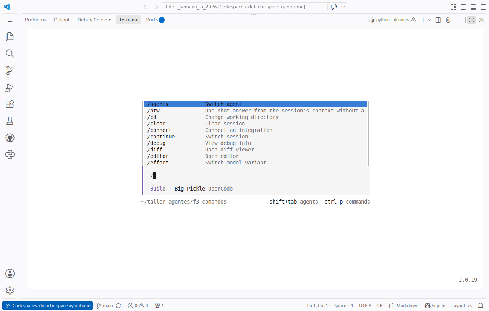

# 🖥️ El modo interactivo de opencode

En el taller usamos opencode en **modo interactivo**: una pantalla en la terminal donde escribes (o pegas) el
encargo, ves trabajar al agente paso a paso, apruebas lo que pide permiso y puedes seguir conversando con él.
Todo lo de esta página es para **opencode 2.0.19**.

> **¿Qué pego?** El texto del bloque «💬 El encargo» de cada enunciado (en la web, el del botón **Copiar**); `python
> taller.py abrir` también te lo enseña antes de abrir opencode. Si el enunciado tiene pasos numerados (F.2, F.3,
> EJ 10, EJ 21), síguelos en orden. **F.0, F.1 y F.9 no se hacen en opencode**: son programas de Python que se lanzan
> con `python taller.py ejecutar …` ([🚀 Primeros pasos](Primeros-pasos.md#los-tres-tipos-de-ejercicio-qué-hago-en-cada-uno)).

## Abrirlo

```bash
python taller.py abrir ej24
```

Abre opencode **en la carpeta de trabajo del ejercicio** (`~/taller-agentes/ej24_…`), con tu `.env` cargado y en modo
`--standalone`. Es lo recomendable.

<details><summary>¿Y a mano, sin taller.py?</summary>

Desde la carpeta de trabajo del ejercicio (nunca desde la del kit):

```bash
cd ~/taller-agentes/ej24_lista_compra
opencode --standalone
```

Sin `--standalone`, opencode 2 se conecta a un servicio en segundo plano que quizá arrancó antes de cargar tu
clave y falla con «Invalid URL» o «No api key». Con el modelo gratuito no hay clave, pero el `--standalone` no sobra.

</details>

## La pantalla

Al abrirlo, opencode ocupa toda la terminal. Abajo, la caja donde escribes; debajo, el agente (**Build**) y el modelo
(**Big Pickle**, el gratuito), y la carpeta en la que trabaja:


> Si pone `/update to install v2.x`, no actualices: el kit está preparado para la **2.0.19**.

En esquema:

```text
┃  Ask anything… "Fix a TODO in the codebase"          ← aquí escribes o pegas el encargo
┃
┃  Build · Big Pickle OpenCode Zen                     ← agente (Build o Plan) y modelo
╹▀▀▀▀▀▀▀▀▀▀▀▀▀▀▀▀▀▀▀▀▀▀▀▀▀▀▀▀▀▀▀▀▀▀▀▀▀▀▀▀▀▀
 ~/taller-agentes/ej24_lista_compra   shift+tab agents   ctrl+p commands
```

Pega el encargo en la caja (`Ctrl+V`) y pulsa **Enter**:


Mientras trabaja verás cada paso: `→ Explored: 2 reads` (lee), `Preparing write…` / `← Write` (escribe),
`$ python …` (ejecuta una orden) y `+ Thought` (piensa). A la derecha, el título de la conversación y cuánto
**contexto** lleva gastado. Abajo, `esc interrupt` para pararlo:


Al final, su respuesta, con el modelo y el tiempo que ha tardado (`Build · Big Pickle · 57.7s`):


## Teclas que necesitas

| Tecla | Qué hace |
|---|---|
| **Enter** | Envía lo que has escrito |
| `Ctrl+V` (o clic derecho en la consola clásica de Windows) | Pega el encargo copiado |
| **Esc** | Interrumpe al agente mientras trabaja (abajo pone `esc interrupt`) |
| **Ctrl+C** | Con texto en la caja, lo borra. **Con la caja vacía, sale de opencode** |
| `/exit` + Enter | También sale |
| **Shift+Tab** | Cambia de agente: **Build** (hace cosas) ↔ **Plan** (solo analiza y propone, no toca nada) |
| **Ctrl+P** | Paleta con todos los comandos |
| `/` | Lista de comandos: escribe unas letras para filtrar y Enter para elegir |

## Comandos útiles (empiezan por `/`)

| Comando | Para qué |
|---|---|
| `/new` | Conversación nueva (el agente olvida lo anterior; los ficheros se quedan) |
| `/models` | Cambiar de modelo (por ejemplo, a otro gratuito) |
| `/sessions` | Volver a una conversación anterior |
| `/init` | Crea un `AGENTS.md` guiado para el proyecto (lo verás en F.2) |
| `/mcps` | Servidores MCP conectados (F.5 y F.6) |
| `/help` | Ayuda |
| `/exit` | Salir |
| `/informe-semanal` | Ejemplo de **comando propio** del ejercicio F.3: el encargo guardado en `.opencode/commands/` |

Al escribir `/` aparecen también los comandos del proyecto (los de `.opencode/commands/`). Sigue escribiendo para
filtrar y pulsa **Enter** para elegir uno; luego **Enter** otra vez para enviarlo (si el comando admite argumentos,
escríbelos antes: `/resumen-mes junio`).



## Cuando pide permiso

Algunas órdenes están en `ask` en el `opencode.json` del kit (`git push`, `crontab`, `systemctl`, `schtasks`,
`launchctl`). Cuando el agente quiere ejecutar una, se para y te pregunta:

```text
┃  △ Permission required
┃  $ systemctl --user enable --now vigila.timer
┃   Allow once   Always allow   Reject        ⇆ select   enter confirm
```

- **Allow once**: solo esta vez. **Always allow**: esta orden, el resto de la sesión. **Reject**: no.
- Elige con las flechas (o Tab) y confirma con **Enter**.
- **Lee la orden antes de aprobarla**: ¿qué hace?, ¿se puede deshacer? Es el punto del EJ 21.

Lo que está en `deny` (borrar en recursivo, `sudo`, `kill`, `taskkill`…) ni siquiera pregunta: se rechaza.
Detalles en [⚙️ opencode.json](opencode-json.md).

## Seguir conversando

No hace falta acertar a la primera. Después de su respuesta puedes escribir:

- «Comprueba que lista_compra.md tiene las cantidades multiplicadas por 1,5.»
- «Has puesto la miel en la lista, pero está en despensa.txt. Corrígelo.»
- «Explícame qué orden has ejecutado y por qué.»

Y luego, fuera de opencode, `python taller.py comprobar ej24`. Manda el comprobador, no lo que diga el agente.

## Salir y volver

Al salir, opencode escribe algo como:

```text
Session   Crear informe semanal de ventas en PPTX
Continue  opencode -s ses_ed5d6a2c5ffe…
```

Para retomar la conversación, desde la misma carpeta: `opencode --standalone -s ses_…` (esa sesión) o
`opencode --standalone -c` (la última). Con `python taller.py abrir ej24` empiezas una conversación nueva en la misma
carpeta: los ficheros que creó siguen ahí.

## Modo interactivo o `opencode run`

| | Interactivo (`taller.py abrir`) | De una vez (`taller.py lanzar`, `opencode run`) |
|---|---|---|
| Ves cada paso | Sí, en pantalla completa | Sí, como texto que va saliendo |
| Permisos en `ask` | Te pregunta | Se queda colgado: no hay nadie para contestar |
| Conversar y corregir | Sí | No (lanza otro encargo) |
| Comandos `/x` | Sí | No (en la 2.x no existe `run --command`) |
| Para qué | **El taller** | Repetir, medir (F.9) y validar los ejercicios |
