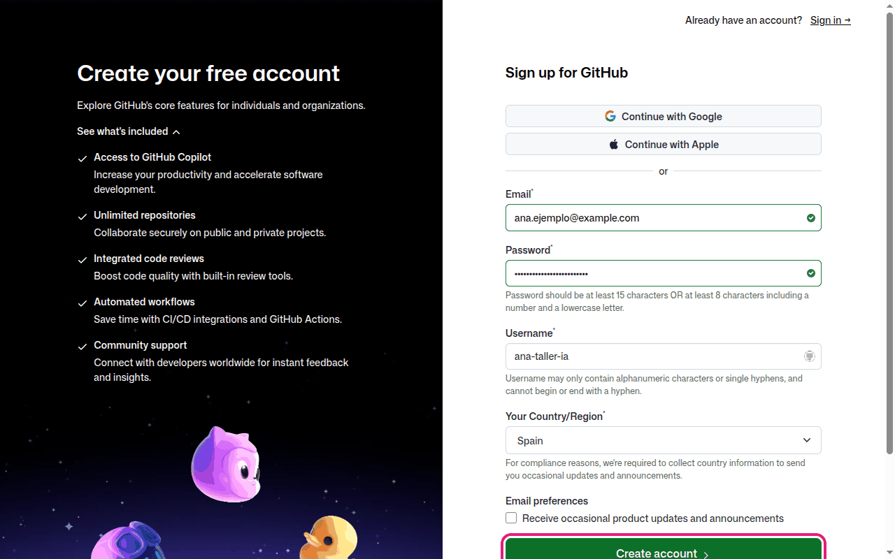
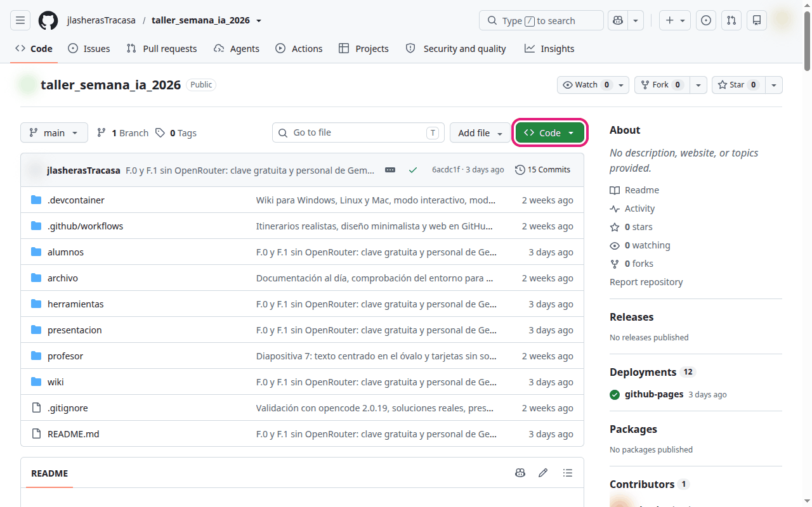
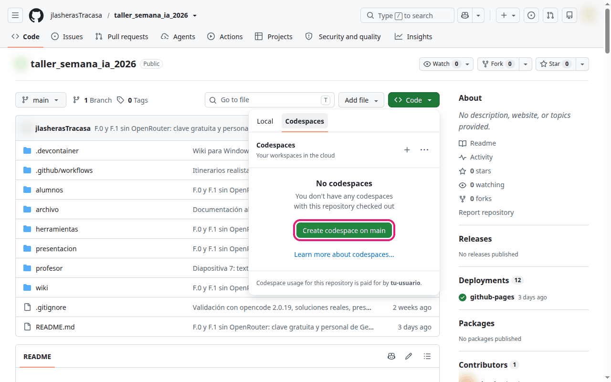
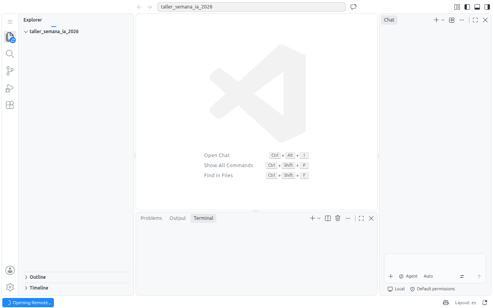
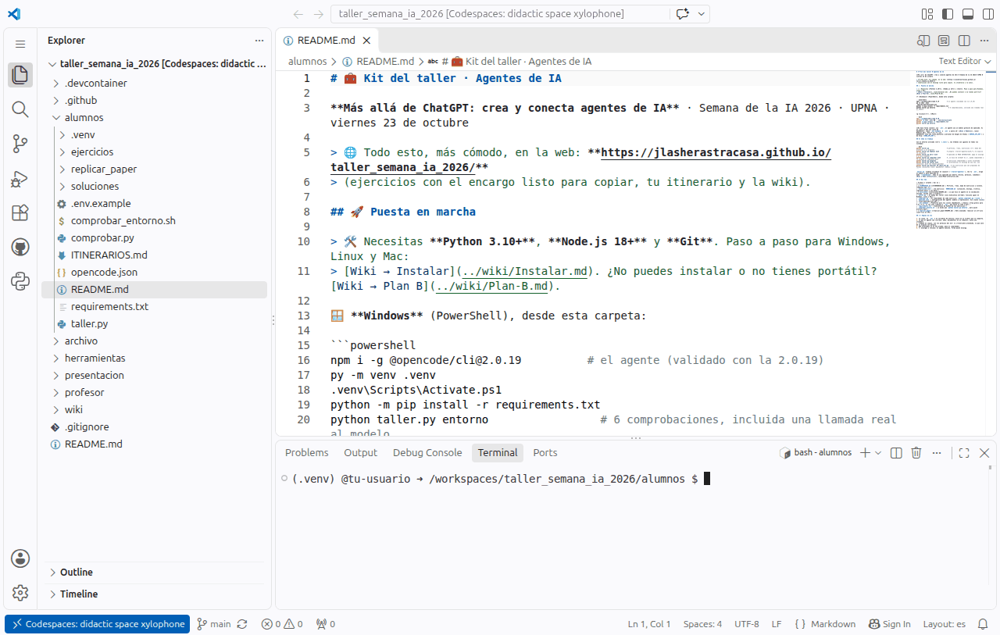
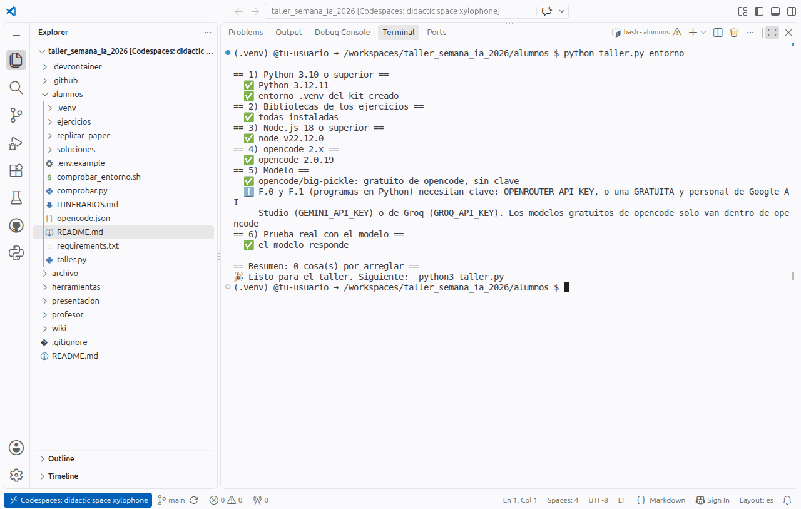
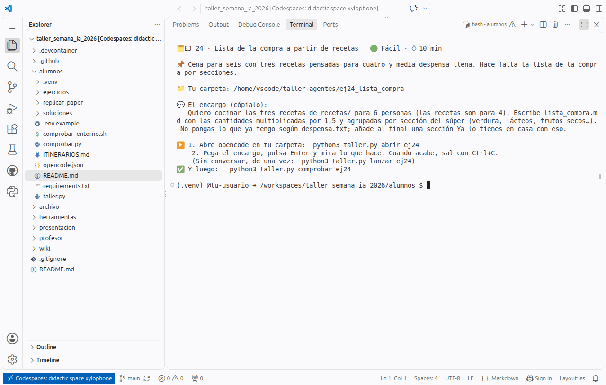
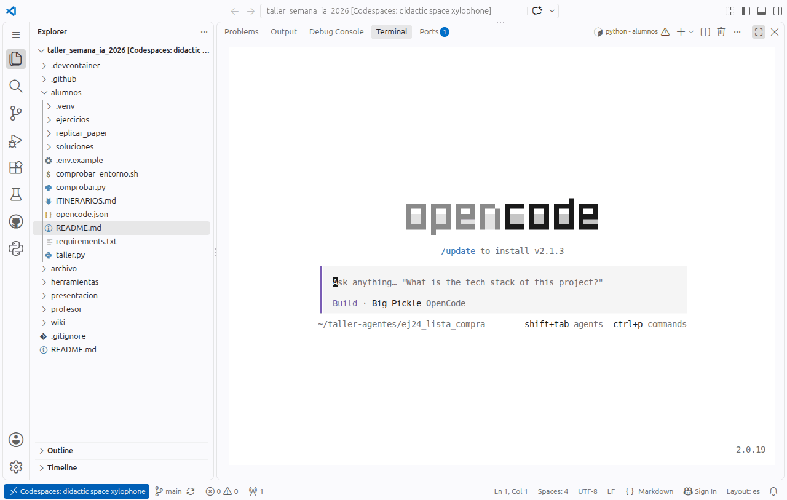

# 🆘 Plan B: sin portátil o sin poder instalar

Para quien no traiga portátil y tenga que usar un ordenador del aula de la UPNA, o no pueda instalar nada en el
suyo. De más a menos parecido a trabajar en tu propio ordenador:

| | Opción | Necesitas | Tiempo |
|---|---|---|---|
| 1 | Instalar en tu usuario, sin administrador (Windows) | Poder descargar y ejecutar programas | 15 min |
| 2 | **GitHub Codespaces**: todo en el navegador | Un navegador y una cuenta gratuita de GitHub | 5 min |
| 3 | En pareja | Un compañero con el kit funcionando | 0 min |
| 4 | «En seco», con las soluciones reales | Solo un navegador | 0 min |

## 1. Instalar sin permisos de administrador (Windows)

Muchos ordenadores de aula no dejan instalar programas «para todos», pero sí en tu carpeta de usuario.

1. **Python**: instalador de <https://www.python.org/downloads/>. Marca **«Add python.exe to PATH»** y pulsa
   *Install Now*: se instala solo para tu usuario. Si pide administrador, desmarca *«Use admin privileges when
   installing py.exe»*.
2. **Node.js sin instalar**: en <https://nodejs.org/en/download> descarga el **.zip** de Windows (x64), no el
   instalador, y descomprímelo en `C:\Users\<tú>\node`. En cada PowerShell nuevo:

   ```powershell
   $env:Path = "$HOME\node;$env:Path"
   node --version
   ```

3. **Git**: no hace falta. En GitHub, **Code → Download ZIP** y descomprime el kit en tu carpeta. Si quieres Git Bash
   (opencode lo usa para sus órdenes en Windows), el *Portable Git* de <https://git-scm.com/download/win> tampoco pide
   administrador.
4. Sigue en [🛠️ Instalar](Instalar.md) desde el paso 2 (`npm i -g @opencode/cli@2.0.19`, el `.venv`…). Con el Node
   del zip, `npm i -g` instala opencode dentro de esa misma carpeta: no necesita permisos.

Si el antivirus o la política del aula bloquean ejecutables en tu carpeta, pasa a la opción 2.

## 2. GitHub Codespaces: el kit en el navegador

Un **Codespace** es un ordenador Linux en la nube, con VS Code en el navegador. El repositorio del taller trae una
configuración (`.devcontainer/`) que lo deja todo instalado: Python, Node, opencode 2.0.19 y las bibliotecas. Con el
modelo gratuito no hace falta ninguna clave.

### 1. Crea una cuenta gratuita de GitHub (si no la tienes)

Entra en <https://github.com/signup>. Puedes registrarte con **Google** o con correo: correo, contraseña (al menos
15 caracteres, u 8 con un número y una minúscula), nombre de usuario y país. Pulsa **Create account**, resuelve el
pequeño puzle y escribe el código que te llega al correo. La cuenta gratuita incluye unas 60 horas al mes de
Codespaces: el taller usa tres.



### 2. Abre el repositorio y pulsa «Code»

Con la sesión iniciada, abre <https://github.com/jlasherasTracasa/taller_semana_ia_2026> y pulsa el botón verde
**Code**.



### 3. Pestaña «Codespaces» → «Create codespace on main»



### 4. Espera a que se prepare (unos 3 minutos la primera vez)

Se abre una pestaña nueva con VS Code. Abajo a la izquierda pone *Opening Remote…* mientras instala todo.



Cuando termina verás el explorador de ficheros a la izquierda, el README del kit y una **terminal** abajo, ya en la
carpeta `alumnos` y con el entorno activado (`(.venv)`):



> 💡 Si VS Code pregunta **«Do you trust the authors of the files in this folder?»**, pulsa **Trust Folder &
> Continue**: es el repositorio del taller.
>
> 💡 Si no ves la terminal: menú ☰ → *Terminal → New Terminal*. Si a la derecha se abre el panel **Chat**
> (Copilot), ciérralo con su ✕: en el taller usamos opencode, no Copilot.
>
> ⚠️ Al arrancar, la extensión de Python de VS Code escribe sola `source …/activate` en la terminal y **corta lo que
> se esté ejecutando** en ese momento. Si ves un `KeyboardInterrupt` en tu primera orden, repítela.

### 5. Comprueba el entorno

```bash
python taller.py entorno
```



### 6. Haz un ejercicio

```bash
python taller.py empezar ej24
python taller.py abrir ej24
```



opencode se abre dentro de la terminal del navegador y funciona igual que en un portátil. Pega el encargo y pulsa
**Enter**:




> No le hagas caso si sugiere `/update to install v2.x`: el kit está preparado para la **2.0.19**.

Sal con `Ctrl+C` y comprueba: `python taller.py comprobar ej24`.

### 7. Al terminar: para el Codespace

Un Codespace parado no gasta horas. En <https://github.com/codespaces> → ⋯ junto al tuyo → *Stop codespace* (o
*Delete* si ya no lo vas a usar).

### Más cosas útiles

- Los ficheros que cree el agente están en `~/taller-agentes/`. Para abrir uno en el editor:
  `code ~/taller-agentes/ej24_lista_compra/lista_compra.md`. Para descargarlo: clic derecho → *Download*.
- ¿Una web (EJ 01)? `python -m http.server 8000 -d ~/taller-agentes/ej01_pagina_personal` y abre el aviso
  *Open in Browser* que sale abajo a la derecha (o la pestaña **Ports**).
- Si quieres usar una clave (Groq para F.0 y F.1, u OpenRouter), crea `.env` en `alumnos/` como en
  [🤖 Modelos](Modelos.md). No subas ese fichero (git ya lo ignora).
- Los ejercicios que tocan el sistema (EJ 21, tareas programadas) funcionan a medias: un Codespace no tiene cron ni
  systemd de usuario. Elige otro.

## 3. En pareja

Siéntate con alguien que tenga el kit funcionando. Turnaos: uno escribe el encargo y el otro lee en voz alta lo que
hace el agente y decide si aprobar cada permiso. Es como se trabaja mejor con los perfiles 🧭 Explorador/a, y la
mitad de lo que se aprende en el taller es **revisar**, no teclear.

## 4. «En seco», con las soluciones reales

Si nada de lo anterior funciona, puedes seguir el taller con lo que hizo el agente cuando se validaron los ejercicios:

1. En la [web del taller](https://jlasherastracasa.github.io/taller_semana_ia_2026/) abre un ejercicio y lee el
   encargo.
2. Abre su carpeta en `alumnos/soluciones/<ejercicio>/` (en GitHub): `prompt.txt` (el encargo), `salida.txt` (todo
   lo que hizo el agente, paso a paso) y `ficheros/` (lo que creó).
3. Revisa tú el resultado con el **criterio** del enunciado: ¿cuadran los totales?, ¿falta algo?, ¿cayó en la
   trampa? Es exactamente lo que hace el comprobador.

Las demos del profesor (🎥) se ven en el proyector, así que esa parte del taller no cambia. Y las prácticas puedes
hacerlas después en casa con [🛠️ Instalar](Instalar.md) y preguntar las dudas al profesor.

## Si lo que falla es el modelo

Si el modelo gratuito no responde o da error de límite (puede pasar con toda el aula conectada a la vez):

1. Espera un minuto y repite.
2. Cambia a otro gratuito: dentro de opencode, `/models`.
3. Usa la clave de OpenRouter que se dé en clase ([🤖 Modelos](Modelos.md)).
