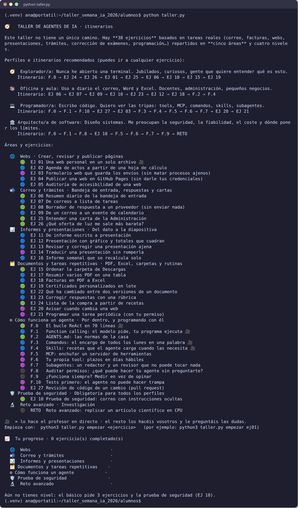
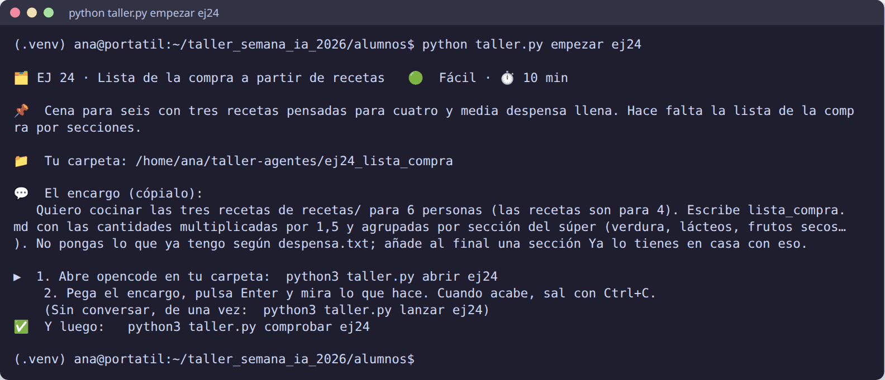
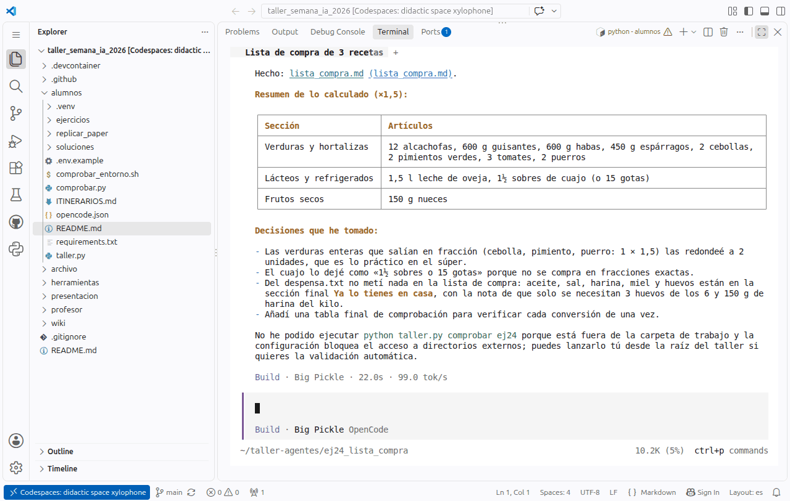

# 🚀 Primeros pasos

Antes: [🛠️ Instalar](Instalar.md) (Python, Node.js, Git, opencode y el kit). ¿No puedes instalar? [🆘 Plan B](Plan-B.md).

Las órdenes son iguales en Windows, Linux y Mac **con el entorno activado** (verás `(.venv)` al principio de la línea):

| | Para activar el entorno, desde la carpeta `alumnos` |
|---|---|
| 🪟 Windows (PowerShell) | `.venv\Scripts\Activate.ps1` |
| 🐧 Linux · 🍎 macOS | `. .venv/bin/activate` |

## 1. ¿Qué modelo vas a usar?

**No necesitas clave.** Sin `.env`, el kit usa un **modelo gratuito de opencode** (`opencode/big-pickle`). Si en
clase os dan una clave de **OpenRouter**, ponla así:

```powershell
copy .env.example .env        # Windows
```

```bash
cp .env.example .env          # Linux y Mac
```

Abre `.env` con el Bloc de notas (o cualquier editor) y rellena `OPENROUTER_API_KEY=` con la clave. En clase, la
clave se ve en la web con un PIN que da el profesor: [🔑 Clave de clase](Clave-de-clase.md). Con ella, el
kit usa **GLM-5.3-Flash**, el modelo con el que se validaron los ejercicios. Más detalles en
[🤖 Modelos](Modelos.md) y [🔑 Variables de entorno](Variables-de-entorno.md).

¿Sin clave de OpenRouter y quieres hacer F.0 y F.1 (los dos ejercicios que son programas de Python)? Saca una clave
**gratuita y personal** de [Groq](https://console.groq.com/keys), sin tarjeta, y ponla en `.env` en la línea
`GROQ_API_KEY=`. Los pasos, con capturas, en [🤖 Modelos](Modelos.md), apartado «F.0 y F.1 gratis».

> 🔐 `.env` es tuyo y de nadie más: no lo subas a git, no lo pegues en un chat, no lo enseñes en pantalla.

## 2. Comprueba que todo está listo

```bash
python taller.py entorno
```

Seis comprobaciones, cada una con ✅ o ❌ y, si falla, qué hacer. La última hace una llamada real al modelo. Al final
tiene que poner **«0 cosa(s) por arreglar»**:


## 3. Mira el menú

```bash
python taller.py
```

Perfiles, itinerarios, áreas y ejercicios. Los marcados con 🎥 los hace el profesor **en directo**; el resto son
**prácticas** que haces tú (y en las que preguntas al profesor cuando te atasques). El color es la dificultad:
🟢 fácil, 🔵 medio, 🟣 avanzado, ⚫ experto. Al final, tu progreso:



## 4. Tu primer encargo, en modo interactivo

```bash
python taller.py empezar ej24      # prepara ~/taller-agentes/ej24_lista_compra y te cuenta la situación
python taller.py abrir ej24        # abre opencode en esa carpeta
```

`empezar` te cuenta la situación, te dice dónde está tu carpeta y te da el encargo para copiar:



Con `abrir` se abre opencode a pantalla completa. **Copia el encargo** que te ha enseñado `empezar` (también está en el
enunciado y en la web), **pégalo** en la caja de abajo (`Ctrl+V`, o clic derecho en Windows) y pulsa **Enter**.


Mira lo que hace: qué ficheros lee (`→ Read`), qué escribe (`← Write`), qué órdenes ejecuta. Al terminar te explica
qué ha hecho y abajo pone el modelo y lo que ha tardado:



Cuando termine, sal con **`Ctrl+C`** (con la caja vacía) o escribiendo `/exit`. Todo lo del modo interactivo, en
[🖥️ Modo interactivo](Modo-interactivo.md).

## 5. ¿Lo ha hecho de verdad?

```bash
python taller.py comprobar ej24
```


Si sale ✅, el ejercicio cuenta como completado y te propone el siguiente. Si sale ❌, vuelve a abrir opencode
(`python taller.py abrir ej24`) y pídele que lo arregle, o mejora el encargo.

Abre `~/taller-agentes/ej24_lista_compra/lista_compra.md` y compruébalo tú también: ¿son 1,2 kg de pochas?

## Los tres tipos de ejercicio: qué hago en cada uno

No todos los ejercicios se hacen igual. Lo dice la cabecera del enunciado, en el apartado 🛠️:

| En la cabecera pone… | Ejercicios | Qué haces |
|---|---|---|
| 🛠️ **opencode interactivo** | La mayoría (EJ 01, EJ 24, F.4…) | `python taller.py abrir <ej>`, **pegas el encargo** que aparece en el bloque «El encargo» (el del botón de copiar) y Enter. Es lo de arriba |
| 🛠️ **solo opencode interactivo**, o un encargo con pasos numerados | F.2, F.3, EJ 10, EJ 21 | Sigue los **pasos numerados** del enunciado, en orden. Te dicen qué abrir y qué pegar en cada momento. En F.3 no se pega nada: se escribe un comando, `/informe-semanal` |
| 🛠️ **tu propio programa en Python** | F.0, F.1, F.9 | **No se usa opencode.** Escribes la orden `python taller.py ejecutar …` en la terminal y miras lo que imprime. Si quieres hacerle otra pregunta, va **entre comillas** detrás del nombre del programa |

Ejemplo del tercer tipo (F.1, la calculadora):

```bash
python taller.py ejecutar f1 fc_calculadora.py
```

Con tu propia pregunta, entre comillas:

```bash
python taller.py ejecutar f1 fc_calculadora.py "¿Cuánto es 9**9**9?"
```

Y para probar la calculadora sola, sin el modelo:

```bash
python taller.py ejecutar f1 fc_calculadora.py --sin-modelo "9**9**9"
```

F.0 y F.1 necesitan una clave en `.env` (la de OpenRouter o una gratuita de Groq: [🤖 Modelos](Modelos.md)); sin
ella, son demos que mira toda la clase en el proyector. Esos ejercicios no tienen comprobador: `comprobar` te recuerda
que lo revises tú con la lista «✅ ¿Lo ha hecho de verdad?» del enunciado.

> 💡 Las órdenes `python taller.py …` se escriben **siempre en la terminal, fuera de opencode**, desde la carpeta
> `alumnos` y con el entorno activado. Dentro de opencode solo se escribe el encargo (o un comando que empieza por `/`).
> Si estás dentro de opencode y quieres escribir una orden, sal antes con `Ctrl+C`.

## ¿Y si prefiero no conversar?

`python taller.py lanzar ej24` hace el encargo de una vez, sin abrir la pantalla interactiva (modo `opencode run`),
guarda lo que pasa en `salida.txt` y te dice cuántos tokens ha gastado. Es como se validaron los ejercicios. En clase
usaremos el modo interactivo: se ve mejor qué hace el agente y puedes aprobar permisos y corregirle sobre la marcha.

## Dónde están tus cosas

| Qué | Dónde |
|---|---|
| El kit (no lo toques) | `taller_semana_ia_2026/alumnos/` |
| Tus carpetas de trabajo (copias) | `~/taller-agentes/<ejercicio>/` · en Windows, `C:\Users\<tú>\taller-agentes\`. La ruta exacta, lo que hay dentro y abrirla en el explorador: `python taller.py carpeta ej24` |
| Empezar un ejercicio de cero | `python taller.py empezar ej24 --de-cero` (borra tu carpeta de trabajo de ese ejercicio y la prepara otra vez) |
| Tu progreso | `~/taller-agentes/progreso.json` (`python taller.py progreso`) |
| Una solución de ejemplo de cada ejercicio | `alumnos/soluciones/<ejercicio>/` |
